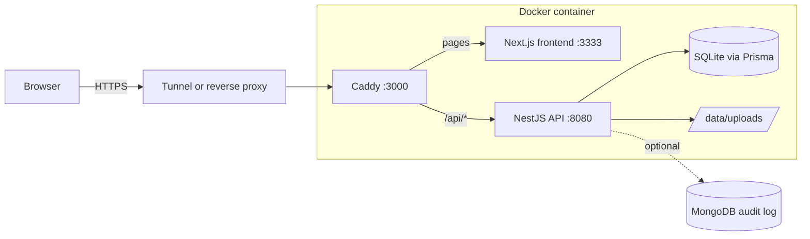

# RV Files

RV Files is a self-hosted file-sharing service. Owners upload files and share them by link. A link can expire, need a password, have a view limit, or be revoked. Nothing a user uploads is allowed to harm the service or the people who open the link.

It is a hardened fork of [Pingvin Share X](https://github.com/smp46/pingvin-share-x), built for the PS2 hackathon brief. The full requirements are in [`docs/PRD.md`](docs/PRD.md) and the design rationale is in [`docs/superpowers/specs/2026-10-28-ps2-file-sharing-design.md`](docs/superpowers/specs/2026-10-28-ps2-file-sharing-design.md).

## Features

- **Unguessable links.** The server makes every share ID from 128 random bits. IDs sent by the client are ignored.
- **Link controls.** Expiry (default 1 day, max 7 days), password, view limit, revoke, expire now, delete.
- **Clear recipient states.** Not found, expired, revoked, view limit reached and wrong password each get their own message.
- **Safety card.** Before downloading, the recipient sees who shared the file, its type and size, the checks that ran, a live expiry countdown, views left and whether a password is set.
- **Server-enforced limits.** 10 MB per share, 50 MB storage quota per user, and an extension blocklist.
- **Safe serving.** Files are sent with a sandboxing CSP, `nosniff`, and as attachments, so an uploaded HTML or SVG file cannot run script on the site.
- **Owner dashboard.** Views, downloads and an activity log for each share.
- **Tripwire.** A share is revoked automatically when it sees too many wrong passwords or a burst of downloads from many IPs.
- **Optional tamper-evident audit log.** Security events can be copied to MongoDB as a hash chain that an admin can verify.

## Quick start

You need Docker.

```bash
git clone https://github.com/Legendofallpro/RV-files.git
cd RV-files
docker compose up --build -d
```

Open <http://localhost:3000>. **The first account you register becomes the admin**, so register it before you share the URL with anyone. Data is stored in `./data`.

There is no published image for RV Files yet. Do not use the upstream `smp46/pingvin-share-x` image: it does not include the RV Files changes.

### Behind a tunnel or reverse proxy

`docker-compose.local.yml` is set up for a [cloudflared](https://developers.cloudflare.com/cloudflare-one/connections/connect-networks/) quick tunnel. It serves on port 3001 and trusts two proxy hops.

```bash
docker compose -f docker-compose.local.yml up --build -d
cloudflared tunnel --url http://localhost:3001
```

A quick-tunnel URL changes every time the tunnel restarts, and the machine running it must stay awake.

If you deploy behind another proxy or on a PaaS, set `TRUST_PROXY=true` and set `TRUST_PROXY_HOPS` to the number of proxies in front of the backend, counting the container's own Caddy. Without this, every request appears to come from the proxy, and rate limits and the tripwire stop working. See [`.env.example`](.env.example).

## Architecture



One container runs Caddy, the Next.js frontend and the NestJS API. Caddy sends `/api/*` to the API and all other requests to the frontend. On startup the container applies Prisma migrations, seeds the default config, then starts the API (`scripts/docker/entrypoint.sh`).

The SQLite database and uploaded files live in `./data`, mounted at `/opt/app/backend/data`. They survive `docker compose restart` and image rebuilds. Only deleting `./data` removes them.

Every upload chunk goes through the API. S3 presigned direct uploads are disabled, so no upload can skip the size, quota and file-type checks. Storage is local disk.

## How it works

### Uploading

1. The owner creates a share. The server generates its ID with `crypto.randomBytes(16)` encoded as base64url, which gives 22 characters (`backend/src/utils/shareId.util.ts`). Passwords are hashed with argon2.
2. The browser sends the file in chunks to `backend/src/file/file.controller.ts`. Only the share's owner can upload to it.
3. Before each chunk is written, `backend/src/file/local.service.ts` checks the share size limit and the owner's storage quota.
4. The file name is checked against the blocklist on the first chunk, on `upload-init`, and again after the last chunk.

Files are stored on disk as `data/uploads/shares/<shareId>/<fileId>`, where `<fileId>` is a UUID. The user's file name is kept only in the database, so it never becomes part of a disk path.

### Opening a link

The server checks every request in this order (`backend/src/share/guard/shareSecurity.guard.ts`, `backend/src/share/share.service.ts`):

1. The share exists.
2. It is not revoked (`removedReason` is empty).
3. It has not expired.
4. The password matches, if the share has one. The password endpoint is rate-limited.
5. The view limit has not been reached.

When all checks pass, the server sets a share token cookie. The token is a JWT that expires with the share and includes a signature of the password hash, so changing the password invalidates every old token. Downloads check the token again.

### Safe file serving

Every file response carries these headers:

- `X-Content-Type-Options: nosniff`
- `Content-Security-Policy: sandbox; default-src 'none'; img-src 'self'; media-src 'self'`
- `Content-Disposition: attachment`

Only passive media may be shown inline: images other than SVG, audio, video, and plain text. The extension blocklist adds a second layer, but these headers are the main protection.

The file type on the safety card comes from the file extension, not from the file's contents.

### Blocked file types

These extensions are rejected (`backend/src/utils/fileNamePolicy.util.ts`):

`exe bat cmd sh ps1 js mjs html htm shtml xhtml xht svg svgz hta vbs msi scr jar apk dll`

Names starting with a dot, such as `.htaccess`, are also rejected. Every extension in the name is checked, so `report.html.txt` is blocked. Trailing dots and spaces are trimmed first, so `evil.exe.` is blocked too.

### Tripwire

Every view, download and wrong password is stored as an access event (`backend/src/share/accessEvent.service.ts`). IP addresses are stored only as `sha256(ip + server secret)`, never in plain text. After each event the server looks at the share's last 10 minutes and revokes it automatically if either rule matches (`backend/src/utils/tripwire.util.ts`):

| Rule                                              | Message shown to recipients             |
| ------------------------------------------------- | --------------------------------------- |
| 5 or more wrong passwords                         | Auto-revoked: too many wrong passwords  |
| 20 or more downloads from 5 or more different IPs | Auto-revoked: unusual download activity |

An admin can change all four thresholds. The owner's activity log shows the event type, time and user agent, but not the IP hash.

### Audit log (optional)

Set `MONGODB_URI` in `.env` to copy security events to MongoDB (`backend/src/audit/`). The logged events are share created, file uploaded, download, wrong password, revoke, tripwire revoke, share deleted and failed sign-in. Views and "expire now" are not logged.

Each record stores `prevHash` and `hash = sha256(prevHash + record)`. The admin-only endpoint `GET /api/audit/verify` walks the newest 500 records and reports `brokenAt` if any of them was edited. If MongoDB is unreachable, the app keeps working, because the audit log is a copy and never a dependency.

## Configuration and limits

All limits are checked on the server. Defaults are in `backend/prisma/seed/config.seed.ts` and can be changed in the admin settings.

| Setting                     | Default                 | Notes                                                                                                  |
| --------------------------- | ----------------------- | ------------------------------------------------------------------------------------------------------ |
| `share.maxSize`             | 10 MB                   | Per share. A per-user `shareSizeLimit` overrides it.                                                   |
| `share.defaultStorageQuota` | 50 MB                   | Per user. A per-user `storageQuotaLimit` overrides it.                                                 |
| `share.maxExpiration`       | 7 days                  | Default expiry is 1 day. Admins are not limited by this cap.                                           |
| `share.fileRetentionPeriod` | 0 days                  | How long expired shares are kept before the cleanup job deletes them.                                  |
| Tripwire limits             | 5 / 20 / 5 IPs / 10 min | `share.tripwirePasswordLimit`, `tripwireDownloadLimit`, `tripwireDistinctIps`, `tripwireWindowMinutes` |

The storage quota counts only active shares, so revoking or expiring a share frees its space at once. A cleanup job runs every minute and deletes expired shares and their files. A revoked share stops being served at once, but its files stay on disk until its original expiry date passes and the cleanup job removes it.

The admin can turn off open registration in the admin settings.

## Testing

```bash
cd backend && npm run test:unit
```

The unit tests cover the file-name policy, share IDs, quota, the tripwire and the audit chain.

The integration tests in `backend/test/integration/*.test.mjs` run over HTTP against a backend that uses a throwaway database. Set `RV_TEST_API`, `RV_TEST_DATA` and `DATABASE_URL` as described at the top of each test file. Never point them at real data.

### Attack demo

`scripts/attack-demo.sh` tries 12 kinds of abuse against a running instance and prints whether the server blocked each one. It covers blocked extensions, an oversized file, a quota overflow, guessed IDs, wrong passwords, expiry, revoke and someone else's share.

```bash
BASE_URL=http://localhost:3001 ./scripts/attack-demo.sh
FAST=1 BASE_URL=http://localhost:3001 ./scripts/attack-demo.sh   # skips the 65 s expiry wait
```

Only a full run against localhost runs all 12 checks. `FAST=1` skips the expiry check, and one check is skipped when the target is not localhost.

## Known limitations

- **Quota race.** The quota check reads current usage and then writes the chunk, in two steps. Two uploads at the same moment could go slightly over the quota. The per-share size limit still holds.
- **Open sign-up.** About ten full accounts could fill a small disk. Turn off registration if that is a risk.
- **Audit verify range.** `GET /api/audit/verify` checks the newest 500 records only. It detects edited records, but it does not detect records deleted from the end of the chain.
- **IP hash salt.** IPs are hashed with the server's JWT secret. Rotating that secret changes every hash, so the tripwire cannot match IPs across a rotation.
- **No virus scanning by default.** ClamAV support from upstream (`backend/src/clamscan/clamscan.service.ts`) works, but needs about 1 GB of RAM. To use it, run a ClamAV container (see `docker-compose.dev.yml`) and turn it on in the admin settings.

Out of scope: end-to-end encryption, email/SMTP, OIDC/LDAP sign-in and a mobile app. Reverse shares are inherited from upstream unchanged and are not part of the hardened scope.

## PS2 brief

The judging questions for the PS2 brief map to these sections:

| Question                        | Where it is answered                                 |
| ------------------------------- | ---------------------------------------------------- |
| 1. Users, abilities, scope      | Features, Known limitations, `docs/PRD.md` section 4 |
| 2. File rules                   | Blocked file types, Configuration and limits         |
| 3. Architecture and flow        | Architecture, How it works                           |
| 4. Storage and restarts         | Architecture                                         |
| 5. Unguessable links and access | Uploading, Opening a link                            |
| 6. End-to-end flow              | Testing, Attack demo                                 |
| 7. Malicious files              | Safe file serving, Blocked file types                |
| 8. Server-enforced limits       | Configuration and limits                             |
| 9. Abuse                        | Tripwire, Audit log                                  |
| 10. Deployment and handover     | Quick start, Testing                                 |

## Contributing

Issues and pull requests are welcome. Please:

- use [Conventional Commits](https://www.conventionalcommits.org) for pull request titles, for example `fix(share): reject expired tokens`
- run `npm run format` and `npm run lint` from the repository root
- add or update tests in `backend/test` for any change to access checks or limits
- never commit `.env`, `./data`, logs or real credentials (they are git-ignored)

AI-assisted code is welcome if you understand it and can explain it in your own words. See [`AI_USAGE_POLICY.md`](AI_USAGE_POLICY.md).

Report security problems privately, as described in [`SECURITY.md`](SECURITY.md).

## Credits and license

RV Files is built on [Pingvin Share](https://github.com/stonith404/pingvin-share) by stonith404 and [Pingvin Share X](https://github.com/smp46/pingvin-share-x) by smp46. Upstream documentation for the inherited features, such as reverse shares, OIDC, LDAP, S3 and ClamAV, is at <https://smp46.github.io/pingvin-share-x/>.

Licensed under BSD-2-Clause, as upstream. See [`LICENSE`](LICENSE).
