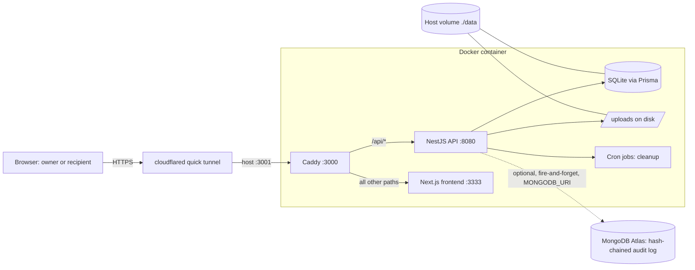

# RV Files: Product Requirements Document

| Field | Value |
|---|---|
| Product | RV Files (hackathon problem statement PS2: file-sharing service) |
| Status | Draft v1, describes the system as built on 2026-10-28 |
| Date | 2026-10-28 |
| Owners | TBD (product), TBD (backend), TBD (frontend), TBD (deployment) |
| Base project | Fork of Pingvin Share X (BSD-2 licence kept, see `LICENSE`) |
| Sources of truth | `README.md` ("PS2 answers"), `docs/superpowers/specs/2026-10-28-ps2-file-sharing-design.md`, `docs/superpowers/plans/2026-10-28-rv-files.md`, and the code under `backend/src` and `frontend/src` |

**How to read this document.** Where the code and the README disagree, this PRD follows the code and flags the difference in section 15.1. Anything not checked against code or a run is marked "Unverified". Paths are relative to the `rv-files/` project root unless stated.

## 1. Summary

RV Files lets a registered owner upload files and share them through an unguessable link. The owner controls each link: expiry (1 day by default, 7 days at most), an optional password, an optional view limit, and revoke, expire or delete at any time. Anyone with the link (a recipient) can open it without an account. The recipient first sees a "safety card" that states who shared the file, what it is, what checks ran, and when the link closes. The server enforces every limit and rule. Two features set it apart: the safety card, and a tripwire that revokes a link automatically when it sees brute-force or download-spray behaviour. An optional off-box audit log in MongoDB Atlas, hash-chained so edits can be detected, records security events. The service runs as one Docker container on a laptop and is published through a cloudflared quick tunnel.

## 2. Problem statement and context

### 2.1 PS2 brief

Owners upload files and share them by link. Links can expire or be revoked. Nothing a user uploads may harm the service or the people who open the link. Judging is 10 questions, 5 marks each (spec section 1):

1. Users, scope and what is out of scope.
2. File rules (types, size, quota, expiry).
3. Architecture and upload/download flow.
4. Storage, and survival across restarts.
5. Unguessable links and access enforcement.
6. End-to-end flow works.
7. Malicious-file safety.
8. Server-enforced limits.
9. Abuse and access control.
10. Deployed, runnable and understandable.

### 2.2 Context and constraints

- Build window was 3 to 4 hours, so the team forked Pingvin Share X. It already provided accounts, quota, expiring links, password links and attachment downloads. The team spent its time closing gaps against the rubric.
- Railway sign-ups were disabled, so the live demo runs from a laptop through a cloudflared quick tunnel (`README.md`, answer 10). The Railway path remains a documented fallback and is not verified (see the plan, Task 1 steps 2 and 3, left unchecked).
- The team is comfortable with HTML, CSS, JS, TypeScript and Node.

## 3. Goals and non-goals

### 3.1 Goals

| ID | Goal |
|---|---|
| G1 | A judge can register, upload, share, download, see counts, then revoke or delete, using a live URL. |
| G2 | Every limit (size, quota, expiry, file type, view count) is enforced on the server, never only in the browser. |
| G3 | Share links cannot be guessed (128-bit IDs chosen by the server). |
| G4 | An uploaded file cannot run code in the service's origin or harm a recipient. |
| G5 | Each failure state shows a distinct, human-readable message. |
| G6 | Data survives restarts of the container. |
| G7 | Abuse is detected and contained automatically (tripwire) and recorded (activity log and audit log). |
| G8 | Anyone can run, test and understand the project from the README and the scripted attack demo. |

### 3.2 Non-goals (out of scope)

| Item | Note |
|---|---|
| End-to-end (client-side) encryption | Stretch only, not built. |
| Reverse shares | Left as inherited from Pingvin and not demoed. They must not crash (spec section 8). |
| Email and SMTP | Not configured. The inherited code paths exist but are off by default. |
| OIDC and LDAP sign-in | Inherited, not configured, not demoed. |
| Mobile app | Not built. |
| Restoring a revoked share | The owner re-shares instead (spec change 8). |
| Translations of new strings | New strings are English only. |
| ClamAV scanning on the demo | Supported by the upstream code, off on the demo (needs about 1 GB RAM). |

## 4. Users and personas

| Persona | Account? | How they get the role | Key jobs |
|---|---|---|---|
| Owner | Yes (registered) | Signs up on the open registration page. | Upload files without being able to break the service. Create a link with an expiry, an optional password and an optional view limit. See who viewed and downloaded. Stop sharing at once (revoke, expire or delete). |
| Recipient | No | Holds the link. May also need the password. | Judge whether the file is safe before downloading. Download it. Understand why a link does not work (expired, revoked, view limit, wrong password, not found). |
| Admin | Yes | The first account to register (`backend/src/auth/auth.service.ts`, `signUp`). | Set global limits and tripwire thresholds. Turn off registration if abuse appears. Verify the audit log. |

## 5. User stories and acceptance criteria

Notation: Given / When / Then. "Share" means one link holding one or more files.

### 5.1 Register and log in

**US-01 Register.** As a visitor, I want to create an account so that I can share files.
- Given registration is enabled, when I submit a valid username, email and password, then the account is created and I am signed in.
- Given I am the very first account on a fresh database, then I am the admin.
- Given the admin has set `security.allowRegistration` to false, when anyone posts to `POST /api/auth/signUp`, then the server answers 403 with a "registration not allowed" message.
- Given more than 20 sign-up or sign-in attempts from one IP within 5 minutes, then further attempts get HTTP 429 (`@Throttle` in `backend/src/auth/auth.controller.ts`).

**US-02 Log in.** As an owner, I want to sign in so that I can manage my shares.
- Given valid credentials, then I get a session and reach the dashboard.
- Given wrong credentials, then the server rejects the attempt and writes a `login_failed` audit record (if audit is enabled).

### 5.2 Upload and create a share

**US-03 Upload files.** As an owner, I want to upload files in chunks so that large files do not fail.
- Given I am signed in, when I create a share, then the server generates the share ID and ignores any ID I send (`generateShareId` in `backend/src/utils/shareId.util.ts`).
- Given a file name whose any extension is on the blocked list (for example `evil.HTML`, `a.pdf.exe`, `a.html.`), or a dotfile such as `.htaccess`, when I upload any chunk, then the server answers 400 and nothing is stored.
- Given the total size of the share would exceed 10 MB, when a chunk arrives, then the server answers 413 and stops.
- Given my active storage plus the incoming chunk would exceed 50 MB, then the server answers 413 (chunk path) or 400 (share creation with a declared `size`).
- Given the client tries a direct S3 presigned upload, then the server refuses and tells the client to use chunked upload (`directToS3: false`).

**US-04 Set expiry.** As an owner, I want my link to expire.
- Given I pick no expiry, then the default is 1 day.
- Given I pick an expiry beyond 7 days (or "never") and I am not an admin, then the server answers 400 `maxExpirationExceeded`.

**US-05 Protect with a password.** As an owner, I want a password on the link.
- Given I set a password, then the server stores only an argon2 hash.

**US-06 Limit views.** As an owner, I want the link to stop working after N views.
- Given I set N, then after N counted views the next view is refused with `share_max_views_exceeded`.

**US-07 Copy the link.** As an owner, after the upload completes I see the link with the 22-character ID.

### 5.3 Recipient flow

**US-08 Open a link and see the safety card.** As a recipient, I want to check the file before downloading.
- Given a valid link, when I open `/share/<id>`, then I see a card with: who shared it (display name or username, never the owner's email), file names, sizes and types, the checks performed, a live expiry countdown (or "no expiry" when the expiry is unix 0), views used and left (or unlimited), and a password badge if one is set.
- Given the share has a password, then I must enter it before the card's file list is available.

**US-09 Download.** As a recipient, I want to download.
- Given valid access, when I download a file, then the response carries `X-Content-Type-Options: nosniff` and the sandbox CSP, and is an attachment unless I am previewing a passive media type.
- Given I download a full file (not a range request, not an inline preview) and I am not the owner, then the download counter increases and a `download` access event is recorded.

**US-10 Failure states.** As a recipient, I want to know why a link failed.

| Situation | HTTP | Error code | Message shown |
|---|---|---|---|
| ID does not exist | 404 | `share_not_found` | Not found |
| Owner revoked | 404 | `share_removed` | "Revoked by owner" |
| Tripwire revoked (password) | 404 | `share_removed` | "Auto-revoked: too many wrong passwords" (UI shows "TRIPWIRE", locked after...) |
| Tripwire revoked (downloads) | 404 | `share_removed` | "Auto-revoked: unusual download activity" |
| Expired | 404 | `share_expired` | Expired |
| Password needed, none sent | 403 | `share_password_required` | Password protected |
| Wrong password | 403 | `wrong_password` | Wrong password |
| View limit reached | 403 | `share_max_views_exceeded` | View limit reached |

The gates run in this order: exists, revoked, expired, password, view limit (`ShareSecurityGuard`, `ShareTokenSecurity`, `ShareService.getShareToken`).

### 5.4 Manage shares

**US-11 Dashboard.** As an owner, I want to see my shares with views, downloads and status (`frontend/src/pages/account/shares.tsx`).
- Given I own shares, then I see each share's views (and the view limit), downloads, expiry, and a status of active, revoked, or tripwire.
- Given a share is auto-revoked, then the dashboard marks it "tripwire".

**US-12 Revoke.** As an owner, I want to cut off a link immediately.
- Given I own the share, when I revoke it, then `removedReason` is set to "Revoked by owner" and the share, file and zip routes all return `share_removed`.
- Given another user calls revoke on my share, then the server answers 403 or 404 and the share stays usable.
- Given the share already has a reason (tripwire, ClamAV), then revoke never overwrites it.
- Given a share is revoked or expired, then its files stop counting toward my quota (`getUserActiveStorageUsage`). Files stay on disk until deletion or cleanup.

**US-13 Expire now.** As an owner, I want to end a link by setting its expiry to now (`POST /api/shares/:id/expire`). Recipients then see `share_expired`.

**US-14 Delete.** As an owner, I want to remove the share and its files (`DELETE /api/shares/:id`). The files are removed from disk and the record is deleted.

**US-15 Activity log.** As an owner, I want to see what happened on my link.
- Given I own the share, when I open its activity, then I see up to 50 recent events (view, download, bad password) with time and a browser label.
- Then no IP address or IP hash is returned (`AccessEventService.listForShare` does not select `ipHash`).
- Given I do not own the share, then `GET /api/shares/:id/activity` is refused.

### 5.5 Admin

**US-16 Configure limits.** As an admin, I change settings in the admin config (for example `share.maxSize`, `share.defaultStorageQuota`, `share.maxExpiration`, the tripwire thresholds). The change applies to new requests.

**US-17 Disable registration.** As an admin, I set `security.allowRegistration` to false. New sign-ups are refused (US-01).

**US-18 Verify the audit log.** As an admin, I call `GET /api/audit/verify`.
- Given `MONGODB_URI` is unset, then the response is `{ enabled: false }`.
- Given the chain is intact, then the response is `{ enabled: true, ok: true, checked: N }`.
- Given a record was edited, then the response is `{ ok: false, brokenAt: <seq> }`.
- Given a non-admin calls the endpoint, then it is refused (`JwtGuard` plus `AdministratorGuard`).

### 5.6 Tripwire

**US-19 Password brute force.** Given 5 or more wrong passwords on one share within 10 minutes, then the share is auto-revoked with "Auto-revoked: too many wrong passwords" and the next visitor sees the revoked state.

**US-20 Download spray.** Given 20 or more full downloads from 5 or more distinct IP hashes within 10 minutes, then the share is auto-revoked with "Auto-revoked: unusual download activity".

## 6. Functional requirements

Priority: MUST = needed to meet the PS2 brief or rubric. SHOULD = expected for a credible demo. COULD = nice to have.

| ID | Requirement | Priority | Where implemented |
|---|---|---|---|
| FR-01 | Users can register and sign in. The first registered account is admin. | MUST | `backend/src/auth/auth.service.ts` (`signUp`), `auth.controller.ts` |
| FR-02 | Admin can disable registration (`security.allowRegistration`). | MUST | `auth.controller.ts`, `backend/src/config/config.service.ts` |
| FR-03 | Authenticated owners upload files in chunks through the server. | MUST | `backend/src/file/file.controller.ts`, `file.service.ts`, `local.service.ts` |
| FR-04 | The server generates share IDs: `randomBytes(16)` base64url, 22 characters. It ignores client IDs. | MUST | `backend/src/utils/shareId.util.ts`, `ShareService.create` |
| FR-05 | Reject blocked file names: 21 extensions, every extension segment checked, trailing dots and spaces trimmed, dotfiles blocked. | MUST | `backend/src/utils/fileNamePolicy.util.ts`; called in `file.service.ts` (`create`, `createPreSignedUploadUrls`), `local.service.ts` (final chunk), `s3.service.ts` |
| FR-06 | Cap one share at `share.maxSize` (10 MB default), checked on every chunk. | MUST | `local.service.ts` (`create`), `s3.service.ts` |
| FR-07 | Cap each user's active storage at `share.defaultStorageQuota` (50 MB default) unless the user has an override. Only active shares count. | MUST | `backend/src/utils/storageQuota.util.ts`, `local.service.ts`, `share.service.ts` (`create`) |
| FR-08 | Expiry defaults to 1 day and is capped at 7 days for non-admins. "Never" is refused for non-admins. | MUST | `ShareService.validateExpiration`, `config.seed.ts` |
| FR-09 | Optional share password, stored as an argon2 hash. | MUST | `ShareService.create`, `getShareToken` |
| FR-10 | Optional view limit (`maxViews`), checked in a transaction. | MUST | `ShareService.handleViewCount` |
| FR-11 | Access gates in order: exists, revoked, expired, password, view limit, each with its own error code and message. | MUST | `share/guard/shareSecurity.guard.ts`, `shareTokenSecurity.guard.ts`, `file/guard/fileSecurity.guard.ts` |
| FR-12 | Password check issues a share JWT cookie `share_<id>_token`. It expires with the share and carries an HMAC of the password hash. | MUST | `ShareService.generateShareToken`, `verifyShareToken`, `ShareController.getShareToken` |
| FR-13 | Serve every file response with `nosniff` and CSP `sandbox; default-src 'none'; img-src 'self'; media-src 'self'`. Use attachment disposition except for passive media previews. | MUST | `file.controller.ts` (`FILE_SECURITY_HEADERS`, `getFile`, `getZip`) |
| FR-14 | Count downloads per share. Skip owner downloads, range requests and inline previews. | MUST | `FileController.countDownload`, `Share.downloads` |
| FR-15 | Owner can revoke a share ("Revoked by owner"). | MUST | `POST /api/shares/:id/revoke`, `ShareService.revoke` |
| FR-16 | Owner can expire a share now or delete it. | MUST | `POST /api/shares/:id/expire`, `DELETE /api/shares/:id` |
| FR-17 | Owner-only actions are guarded by ownership. | MUST | `share/guard/shareOwner.guard.ts`, `strictShareOwner.guard.ts` |
| FR-18 | Record access events (view, download, bad_password) with `ipHash = sha256(ip + jwtSecret)` and a user agent. | MUST | `share/accessEvent.service.ts` |
| FR-19 | Tripwire auto-revoke on password brute force and download spray. Thresholds are config keys. | MUST | `backend/src/utils/tripwire.util.ts`, `accessEvent.service.ts`, `config.seed.ts` |
| FR-20 | Owner dashboard shows views, downloads, status, and a per-share activity log. | MUST | `frontend/src/pages/account/shares.tsx` |
| FR-21 | Recipient page shows the safety card (sharer, file names, sizes and types, checks, countdown, views, password badge). | MUST | `frontend/src/pages/share/[shareId]/index.tsx`, `components/share/SafetyCard.tsx`, `ShareService.get` (`safety` block) |
| FR-22 | Recipient page shows a distinct state for not found, revoked, tripwire, expired, view limit and wrong password. | MUST | `frontend/src/pages/share/[shareId]/index.tsx` |
| FR-23 | Rate-limit the token endpoint (20 per 5 min per IP), the share-ID availability route (10 per min) and sign-up and sign-in (20 per 5 min). The global default is 100 per minute. | SHOULD | `@Throttle` in `share.controller.ts`, `auth.controller.ts`, `app.module.ts` |
| FR-24 | Optional hash-chained audit log in MongoDB Atlas. It is fire-and-forget and never blocks the app. | SHOULD | `backend/src/audit/*` |
| FR-25 | Admin endpoint to verify the audit chain and to list recent records. | SHOULD | `audit.controller.ts` (`GET /api/audit/verify`, `GET /api/audit/recent`) |
| FR-26 | A scheduled job removes expired shares and their files, unfinished uploads older than a day, and stale temp chunks. | SHOULD | `backend/src/jobs/jobs.service.ts` |
| FR-27 | Refuse S3 presigned direct uploads so every chunk passes the server checks. | SHOULD | `file.service.ts` (`createPreSignedUploadUrls`, `completePreSignedUpload`) |
| FR-28 | Optional ClamAV scan on share completion. | COULD | `backend/src/clamscan/clamscan.service.ts`, called from `ShareService.complete` |
| FR-29 | Scripted abuse demo that tests each control against a running instance. | SHOULD | `scripts/attack-demo.sh` |
| FR-30 | App branding "RV Files" (default `general.appName`). | COULD | `config.seed.ts` |

## 7. Security and abuse requirements

| # | Threat | Mitigation | Where enforced |
|---|---|---|---|
| T1 | Guess or enumerate share links | 128-bit random IDs; client IDs ignored; availability route throttled to 10/min; unknown ID returns `share_not_found` | `shareId.util.ts`, `ShareService.create`, `share.controller.ts` |
| T2 | Upload an executable or script | Extension blocklist (21 entries), every segment checked, dotfiles blocked, trailing dot/space trimmed. This is defence in depth only. | `fileNamePolicy.util.ts` |
| T3 | Bypass the blocklist by renaming between chunks | Check on every chunk (`FileService.create`) and again on the final chunk before metadata is written; the stored file is deleted on a late block | `file.service.ts`, `local.service.ts` |
| T4 | Hostile file runs script in the service origin (stored XSS) | `nosniff`, CSP `sandbox; default-src 'none'...`, attachment disposition. Inline preview only for non-SVG images, audio, video and `text/plain`. Files are stored under UUID names, so the user-supplied name never forms a disk path. | `file.controller.ts`, `local.service.ts` (`getSafeFilePath`) |
| T5 | Oversized upload | Per-chunk check against 10 MB share limit | `local.service.ts` |
| T6 | Fill the user's or the server's disk | 50 MB per-user quota (active shares only), disk free-space check per chunk, admin can disable registration | `storageQuota.util.ts`, `local.service.ts`, `auth.controller.ts` |
| T7 | Skip server checks with direct-to-S3 upload | Presigned init returns `directToS3: false`; completion throws | `file.service.ts` |
| T8 | Password brute force | argon2 hashes, token endpoint throttled (20 per 5 min per IP), tripwire revokes at 5 wrong passwords in 10 min | `share.controller.ts`, `accessEvent.service.ts` |
| T9 | Download spray / link leak | Tripwire revokes at 20 downloads from 5 distinct IP hashes in 10 min | `tripwire.util.ts` |
| T10 | Use someone else's share (revoke, delete, read activity) | Ownership guards; distinct owner-only routes | `shareOwner.guard.ts`, `strictShareOwner.guard.ts` |
| T11 | Reuse a stale share token after a password change | Token embeds an HMAC of the password hash, checked on every request | `ShareService.verifyShareToken` |
| T12 | Stolen token outlives the share | Token expiry equals share expiry | `ShareService.generateShareToken` |
| T13 | Privacy leak through logs | IPs stored only as `sha256(ip + jwtSecret)`; activity API omits the hash; recipient payload omits owner email | `accessEvent.service.ts`, `ShareService.get` |
| T14 | Spoofed client IP defeats rate limits and the burst rule | Trust only a fixed number of proxy hops (`TRUST_PROXY_HOPS`, 2 in local compose: Caddy and cloudflared) | `backend/src/main.ts`, `docker-compose.local.yml` |
| T15 | Account brute force | Sign-in throttled (20 per 5 min); failed sign-ins audited | `auth.controller.ts`, `auth.service.ts` |
| T16 | Tampering with the security record after the fact | Hash-chained audit log held off-box in Atlas; admin verify endpoint | `backend/src/audit/*` |
| T17 | Malware in a file | ClamAV hook available, off on the demo | `clamscan.service.ts` |
| T18 | Expired data lingers | Cron job deletes expired shares and files (retention default `0 days`) | `jobs.service.ts`, `config.seed.ts` |

## 8. Non-functional requirements

| Area | Requirement |
|---|---|
| Persistence | Metadata (SQLite `pingvin-share.db`) and files (`uploads/shares/<shareId>/<fileId>`) live under `./data`, mounted at `/opt/app/backend/data`. They survive `docker compose restart` and rebuilds. Only deleting `./data` removes them. |
| Availability | Single container, single host, `restart: unless-stopped`. The demo is up only while the laptop is awake and the tunnel runs. There is no redundancy. A Docker healthcheck polls `/api/health`. |
| Privacy | Raw IPs are never stored. The recipient sees the sharer's display name or username, not the email. The audit log holds no raw IPs either (it stores `ipHash`). |
| Performance and limits | 10 MB per share, 50 MB per user, 10 MB upload chunk size, 7-day expiry cap, global rate limit 100 requests/min per IP, file download route 1200/min. These are limits, not measured performance targets. No load testing was done (Unverified). |
| Deployability | One Docker image built from `Dockerfile`. `docker compose -f docker-compose.local.yml up --build -d` starts it. Caddy listens on 3000 inside the container. Host port 3001 maps to it. |
| Observability | Owner activity log, dashboard counters, optional Atlas audit log, NestJS application logs (`docker logs`). No metrics or alerting. |
| Resilience | Audit logging is fire-and-forget. If Atlas is down, a single warning is logged and the app keeps working. |
| Maintainability | Policy logic sits in small pure utilities with unit tests. Upstream code is kept close to the original to ease merges. |
| Accessibility and i18n | New strings are English only. Accessibility was not audited (Unverified). |

## 9. System overview

One Docker container runs three processes behind Caddy: the Next.js frontend (port 3333), the NestJS API (port 8080), and the file and database storage on a mounted volume. Caddy listens on 3000 and routes `/api/*` to NestJS and all other paths to Next.js (`reverse-proxy/Caddyfile`). The host maps 3001 to 3000. cloudflared publishes the host port as a public quick-tunnel URL. The browser only ever talks to the tunnel. Every upload chunk passes through the API, so no check can be skipped. The API stores metadata in SQLite through Prisma and file chunks on local disk. It optionally mirrors security events to MongoDB Atlas.



### 9.1 Upload flow

1. Owner signs in and creates a share (`POST /api/shares`). The server picks the ID and checks the declared size against free disk and quota.
2. The browser sends each chunk (`POST /api/shares/:id/files?name&chunkIndex&totalChunks`). Per chunk the server checks the file name, the 10 MB share limit and the 50 MB quota, then appends to a `.tmp-chunk` file.
3. On the last chunk the server renames the temp file, re-checks the name, and writes the `File` record.
4. The browser calls `POST /api/shares/:id/complete`. The share locks (`uploadLocked`), a zip is built for multi-file shares, and ClamAV runs if enabled.

### 9.2 Download flow

1. Recipient opens `/share/<id>`. The page calls `POST /api/shares/:id/token`, sending the password if needed. The server checks exists, revoked, expired, password, view limit, counts the view and sets the `share_<id>_token` cookie.
2. The page loads share data (`GET /api/shares/:id`) and shows the safety card.
3. The recipient downloads (`GET /api/shares/:id/files/:fileId` or `/files/zip`). `FileSecurityGuard` re-checks state. The controller counts the download, records the event (which runs the tripwire) and streams the file with safe headers.

## 10. Data model summary

Source: `backend/prisma/schema.prisma` (SQLite).

| Model | Key fields | Notes |
|---|---|---|
| `User` | `id`, `username`, `email`, `password` (hash), `isAdmin`, `shareSizeLimit?`, `storageQuotaLimit?`, `allowShare`, `maxShares?` | A null `storageQuotaLimit` falls back to `share.defaultStorageQuota`. A set `shareSizeLimit` overrides `share.maxSize`. |
| `Share` | `id` (22-char server ID), `creatorId?`, `name?`, `description?`, `expiration`, `views`, `downloads`, `removedReason?`, `uploadLocked`, `isZipReady`, `storageProvider`, `reverseShareId?` | `removedReason` non-null means revoked. Expiry unix 0 means "never". |
| `ShareSecurity` | `shareId`, `password?` (argon2), `maxViews?`, `restrictToRecipients` | One row per protected share. |
| `File` | `id` (UUID), `shareId`, `name`, `size` (string) | The UUID is the disk file name. |
| `AccessEvent` | `shareId`, `type` (`view`, `download`, `bad_password`), `ipHash`, `userAgent?`, `createdAt` | Index on `(shareId, createdAt)`. Cascade delete with the share. |
| `Config` | `name`, `category`, `type`, `defaultValue`, `value?` | Holds all admin-editable settings. |
| `RefreshToken`, `LoginToken`, `ResetPasswordToken`, `OAuthUser` | Session and identity tokens | Inherited. |
| `ReverseShare`, `ShareRecipient`, `ShareUserRecipient` | Reverse-share and recipient features | Inherited, out of scope. |

MongoDB Atlas collection `audit_events` (optional): `seq`, `ts`, `action`, `shareId?`, `userId?`, `ipHash?`, `detail?`, `prevHash`, `hash`, where `hash = sha256(prevHash + canonicalJson(record without prevHash and hash))` (`backend/src/audit/auditChain.util.ts`). Actions: `share_created`, `file_uploaded`, `download`, `bad_password`, `revoked`, `auto_revoked`, `share_deleted`, `login_failed`.

## 11. API surface summary

All paths are under `/api`. "Throttle" notes are per IP.

| Endpoint | Guard | Purpose |
|---|---|---|
| `POST /auth/signUp` | Registration flag, throttle 20/5 min | Create account (first becomes admin) |
| `POST /auth/signIn` | Throttle 20/5 min | Sign in |
| `POST /shares` | `CreateShareGuard` | Create a share; server assigns the ID |
| `POST /shares/:id/files?name&chunkIndex&totalChunks` | `IdValidation`, `CreateShareGuard`, `StrictShareOwnerGuard` | Upload one chunk |
| `POST /shares/:id/files/upload-init` | same | Name check; returns `directToS3: false` |
| `POST /shares/:id/files/upload-complete` | same | Always refused (direct upload disabled) |
| `DELETE /shares/:id/files/:fileId` | same | Remove a file before completion |
| `POST /shares/:id/complete` | `IdValidation`, `CreateShareGuard`, `StrictShareOwnerGuard` | Lock the share |
| `GET /shares` | `JwtGuard` | List the caller's non-expired shares |
| `GET /shares/all` | `JwtGuard`, `AdministratorGuard` | Admin list of all shares |
| `GET /shares/:id` | `IdValidation`, `ShareSecurityGuard` | Share data and the `safety` block |
| `GET /shares/:id/metaData` | `IdValidation`, `ShareSecurityGuard` | Light metadata (also starts zip build) |
| `POST /shares/:id/token` | `IdValidation`, `ShareTokenSecurity`, throttle 20/5 min | Check password, count view, set share cookie |
| `GET /shares/:id/files/:fileId?download=` | `FileSecurityGuard`, throttle 1200/min | Stream a file with safe headers |
| `GET /shares/:id/files/zip` | `FileSecurityGuard` | Stream the zip archive |
| `PATCH /shares/:id` | `IdValidation`, `ShareOwnerGuard` | Update name, description, expiry, password, view limit |
| `POST /shares/:id/revoke` | `IdValidation`, `ShareOwnerGuard` | Revoke ("Revoked by owner") |
| `POST /shares/:id/expire` | `IdValidation`, `ShareOwnerGuard` | Set expiry to now |
| `DELETE /shares/:id` | `IdValidation`, `ShareOwnerGuard` | Delete share and files |
| `GET /shares/:id/activity` | `IdValidation`, `ShareOwnerGuard` | Last 50 access events, no IP data |
| `GET /shares/isShareIdAvailable/:id` | Throttle 10/min | Inherited; kept harmless |
| `GET /audit/verify` | `JwtGuard`, `AdministratorGuard` | Verify audit chain |
| `GET /audit/recent` | `JwtGuard`, `AdministratorGuard` | List recent audit records |
| `GET /health` | None | Container health (used by the Docker healthcheck) |

## 12. Configuration and limits

All keys are seeded in `backend/prisma/seed/config.seed.ts`. Seed defaults apply only to a fresh database. An admin can change values later in the admin UI.

| Setting key | Default | Enforced where |
|---|---|---|
| `share.maxSize` | `10000000` (10 MB per share) | `local.service.ts` per chunk (a per-user `shareSizeLimit` overrides it) |
| `share.defaultStorageQuota` | `50000000` (50 MB per user) | `local.service.ts`, `share.service.ts` via `resolveStorageQuota` |
| `share.maxExpiration` | `7 days` | `ShareService.validateExpiration` (skipped for admins) |
| `share.defaultExpiration` | `1 day` | Frontend default in the create-share modal |
| `share.tripwirePasswordLimit` | `5` | `accessEvent.service.ts` |
| `share.tripwireDownloadLimit` | `20` | `accessEvent.service.ts` |
| `share.tripwireDistinctIps` | `5` | `accessEvent.service.ts` |
| `share.tripwireWindowMinutes` | `10` | `accessEvent.service.ts` |
| `share.chunkSize` | `10000000` | Request body limit in `main.ts`, chunk index maths in `local.service.ts` |
| `share.fileRetentionPeriod` | `0 days` | `jobs.service.ts` (expired shares deleted at the next minute-level run) |
| `share.zipCompressionLevel` | `9` | `ShareService.createZip` |
| `security.allowRegistration` | `true` | `auth.controller.ts` |
| `security.allowUnauthenticatedShares` | `false` | Inherited upload guard |
| `security.allowAdminAccessAllShares` | `false` | Share and file guards (admin bypass) |
| `security.sessionDuration` | `3 months` | Auth tokens |
| `general.appName` | `RV Files` | Frontend branding |
| Env `TRUST_PROXY` / `TRUST_PROXY_HOPS` | `true` / `2` in `docker-compose.local.yml` | `backend/src/main.ts` |
| Env `MONGODB_URI` | unset (audit off) | `audit.service.ts` |
| Hard-coded blocklist | 21 extensions + dotfiles | `fileNamePolicy.util.ts` (not configurable) |

Blocked extensions: `exe bat cmd sh ps1 js html htm svg xhtml msi scr jar apk dll shtml xht mjs svgz hta vbs`.

## 13. Success metrics and judging criteria

### 13.1 Rubric coverage

| Q | Criterion | How the product meets it | Demo proof |
|---|---|---|---|
| 1 | Users, scope | Three roles; explicit non-goals (section 3.2) | `README.md` answer 1 |
| 2 | File rules | Blocklist, 10 MB, 50 MB, 1 to 7 day expiry | Attack demo checks 1 to 4 |
| 3 | Architecture, flow | Section 9 | Diagram in `README.md` |
| 4 | Storage, restart | `./data` volume; optional Atlas audit | Restart the container; data persists. A manual check, not in the script (Unverified in this review) |
| 5 | Unguessable links, access | 128-bit IDs, ordered gates | `server-generated-share-id.test.mjs`; check 5 |
| 6 | End-to-end flow | Register, upload, share, open, download, count, revoke | 60-second manual demo; integration tests |
| 7 | Malicious files | Blocklist plus safe serving | Checks 1, 2, 6; `file-safety-limits.test.mjs` |
| 8 | Server-enforced limits | Section 12 | Checks 3, 4, 8 |
| 9 | Abuse control | Ownership guards, tripwire, throttles | Checks 7 and 9 to 12 |
| 10 | Deployed, runnable | Docker compose, tunnel, README | A judge can repeat the README steps |

### 13.2 The attack demo (`scripts/attack-demo.sh`)

Run: `BASE_URL=http://localhost:3001 ./scripts/attack-demo.sh` (add `FAST=1` to skip the 65 s expiry wait). The exit code is the number of failed checks. It needs `curl` and `jq`.

| # | Check | Expected |
|---|---|---|
| 1 | Upload `evil.html` | 400, "not allowed" |
| 2 | Upload `a.pdf.exe` | 400, "not allowed" |
| 3 | Upload 11 MB file | 400 or 413 |
| 4 | Create share declaring 60 MB | 400, quota message |
| 5 | Open unknown share ID | 404 `share_not_found` |
| 6 | Download a `.txt` | 200 with `nosniff` and CSP containing `sandbox` |
| 7 | Revoke, then fetch share, file and zip | All 404 `share_removed` "Revoked by owner" |
| 8 | 1-minute share after 65 s | 404 `share_expired` (skipped with `FAST=1`) |
| 9 | User B revokes, deletes, reads activity of A's share | 403 or 404 each; A's share still downloads |
| 10 | 5 wrong passwords, then open | 404 `share_removed` "Auto-revoked: too many wrong passwords" |
| 11 | 20 downloads from 5 fake IPs | 404 `share_removed` "Auto-revoked: unusual download activity" (skipped against a remote URL) |
| 12 | 30 bad sign-ins | At least one 429 |

README states the latest run passed all 12 checks. That run needs `localhost` as target and no `FAST=1`, because checks 8 and 11 are skipped otherwise. This PRD did not re-run it (Unverified).

### 13.3 Automated tests

| Suite | What it covers | How to run |
|---|---|---|
| `backend/test/unit/policy.test.ts` | Blocklist, ID format and uniqueness, tripwire rules, quota resolution | `cd backend && npm run test:unit` |
| `backend/test/unit/auditChain.test.ts` | Hash chain and verify logic | same |
| `backend/test/integration/server-generated-share-id.test.mjs` | Client IDs replaced, uploads complete with the returned ID, reverse-share path | Needs a running isolated backend: set `RV_TEST_API` and an isolated `DATABASE_URL`, then `node --test` on the file |
| `.../file-safety-limits.test.mjs` | Seeded limits, blocked names on chunk 0 and presigned init, rename between chunks, quota, 10 MB across chunks, header strictness | same |
| `.../revoke-and-states.test.mjs` | Revoke on all routes, token route, expired, never-expiring, not found, cross-user revoke | same |
| `.../access-events-tripwire.test.mjs` | Download counting rules, owner-only activity, both tripwire rules, safety payload without owner email | same |
| `.../s3-file-safety.test.mjs` | S3 path size, quota, range and header behaviour with a stubbed S3 client | Needs built `dist/` and an isolated `DATABASE_URL` under `/tmp/` |

### 13.4 Product success metrics

| Metric | Target |
|---|---|
| Attack-demo checks passing on the judged instance | 12 of 12 (11 of 11 plus a skip if run remotely) |
| Judge completes register, upload, share, download in the 60-second demo | Yes, without help |
| Blocked file reaches disk | 0 |
| Revoked or expired share still served | 0 |
| Raw IPs stored | 0 |

## 14. Release and deployment plan

### 14.1 Environments

| Environment | Method | Status |
|---|---|---|
| Local demo (primary) | Docker compose on a laptop plus cloudflared quick tunnel | In use |
| Railway (fallback) | Build the `Dockerfile` from GitHub, volume at `/opt/app/backend/data`, `TRUST_PROXY=true`, public port 3000 | Documented, not verified (plan Task 1 steps 2 and 3 skipped) |

### 14.2 Runbook

```bash
# 1. Start (builds the image, data in ./data)
docker compose -f docker-compose.local.yml up --build -d

# 2. Check health
curl -fs http://localhost:3001/api/health

# 3. Publish (URL changes on every tunnel restart)
cloudflared tunnel --url http://localhost:3001

# 4. First account to register becomes admin. Register it before sharing the URL.

# 5. Optional audit log: put MONGODB_URI=... in a git-ignored .env, then restart
docker compose -f docker-compose.local.yml up -d

# 6. Run the attack demo from the same machine (full run, includes the 65 s wait)
BASE_URL=http://localhost:3001 ./scripts/attack-demo.sh

# 7. Unit tests
cd backend && npm run test:unit

# 8. Restart check (data must survive)
docker compose -f docker-compose.local.yml restart
```

### 14.3 Pre-judging checklist

- Fresh `./data` so the seeded defaults (10 MB, 50 MB, 7 days, tripwire keys) apply. Seed defaults do not change an existing database.
- Register the admin account first.
- Keep the laptop awake and the tunnel running. Share the new URL with judges.
- Run the attack demo against `http://localhost:3001` and confirm 12 of 12.
- Set `MONGODB_URI` if the audit log will be shown, then call `GET /api/audit/verify` as admin.
- Decide whether to turn off registration before the demo ends.

### 14.4 Rollback

Stop the container, restore `./data` from a backup copy (for example `cp -a data data.bak-$(date +%H%M)` taken before risky changes; `data.bak-*/` is git-ignored), and start again.

## 15. Risks, known limitations and open questions

### 15.1 Differences between the README and the code

The README was rewritten on 2026-10-28 to match the code on every row below. The table is kept as a record of what changed. One correction: revoked shares are not kept forever. Their files are deleted by the cleanup job once the original expiry date passes.

| Topic | README or docs say | Code says | Impact |
|---|---|---|---|
| Blocked extensions | 15 extensions listed in README answer 2 and the plan | 21 extensions (adds `shtml xht mjs svgz hta vbs`) | README list is incomplete. This PRD follows the code. |
| Trusted proxies | `.env.example` says local compose "explicitly uses false" | `docker-compose.local.yml` sets `TRUST_PROXY=true` and `TRUST_PROXY_HOPS=2` | `.env.example` comment is wrong. Code is correct for the tunnel set-up. |
| File name sanitising | "File names are sanitised before they touch the disk" | Files are stored under a UUID; the original name is only stored as metadata. There is no sanitising step because the name never forms a path. | Safe, but the wording is inaccurate. |
| Quota checks | "Enforced in the upload path" | Also at share creation, but only when the client declares `size`. Without `size`, only the per-chunk check applies. | Per-chunk check still closes the gap. |
| Expiry cap | "Expiry capped at 7 days" | Admins skip `validateExpiration`, on create and update | Admin shares can exceed 7 days or never expire. |
| Max share size | "10 MB per share" | A per-user `shareSizeLimit` or reverse-share limit overrides `share.maxSize` | Only admins set these. No user has one by default. |
| Cleanup of expired shares | "Existing cleanup job removes expired shares" | Retention is `0 days`, so the cron removes them within about a minute of expiry. Revoked shares that have not expired are not removed. | Revoked files stay on disk until expiry. |
| Dashboard | Shows expired state | `getSharesByUser` returns only non-expired shares, so expired shares drop from the list | The "expired" tile in `shares.tsx` can only appear on a stale list. Unverified in the UI. |
| Safety card "detected type" | Spec: "detected type" | `fileType()` reads the extension in the name. No content sniffing. | The label is a claim by name, not a verified type. |
| Integration tests | "Run against a running instance" | They need an isolated database and backend (`RV_TEST_API`, `DATABASE_URL`), and one suite needs `dist/` | Judges cannot run them with just the demo URL. |
| Port in spec | Spec says one port 3000 | Container uses 3000; host maps 3001 | No problem. |
| Audit "every security event" | README lists created, uploaded, download, bad password, revoke, tripwire revoke, delete, failed sign-in | Matches the 8 actions. Views are not audited, and expire (owner "expire now") is not audited. | Minor gap. |
| `.gitignore` of audit URI | "git-ignored `.env`" | Confirmed: `.gitignore` line 28 ignores `.env` | None. |

### 15.2 Known limitations

| Limitation | Effect | Mitigation |
|---|---|---|
| Quota check reads then writes (not atomic) | Two simultaneous uploads could slightly exceed 50 MB | The 10 MB per-share cap still holds |
| Quick-tunnel URL changes on restart | Old links to the host stop working until the new URL is shared | Share the new URL. Consider a named tunnel. |
| Laptop must stay awake | Demo goes down if it sleeps | Keep awake; Railway as fallback |
| Open sign-up | About 10 full accounts could fill the disk | Admin disables registration |
| IP-hash salt is `jwtSecret` | Rotating the secret breaks continuity of IP-hash history | Do not rotate during a demo |
| ClamAV off | No malware scan | Safe serving is the main guard. Enable ClamAV locally if needed. |
| Blocklist is name-based | A renamed executable passes | Safe serving headers; recipient must not run downloads |
| Audit `verify` checks the latest 500 records by default | Older edits are not checked; the first record in the window is not compared with the genesis hash; deletion of the newest records would not break the chain (inferred from `verifyDocs`) | Raise the limit; keep an external head-hash note |
| `GET /shares/:id` and `token` count views; page refreshes burn views | A low view limit can be exhausted by reloads | Design choice (spec change 4); documented |
| Revoke/expire frees quota but keeps files | Disk use can exceed quota accounting | Delete shares, or rely on expiry cleanup |
| Reverse shares and OIDC/LDAP code remain | Extra attack surface that is not hardened or demoed | Disabled by default |
| Tripwire download rule needs distinct IPs | One attacker with one IP triggers only the password rule | Throttles apply |
| Attack-demo check 11 works only on localhost | A remote run skips it | Run on the host |

### 15.3 Open questions

| # | Question | Owner |
|---|---|---|
| Q1 | Should admins also be bound by the 7-day expiry cap? | TBD |
| Q2 | Should owner downloads count? Current code: no. | TBD |
| Q3 | Should the safety card sniff real file types (magic bytes) instead of showing the extension? | TBD |
| Q4 | Should revoked shares be purged from disk on a schedule? | TBD |
| Q5 | Should expired shares remain visible in the owner dashboard? | TBD |
| Q6 | Do we keep Railway as a supported fallback, and who verifies it? | TBD |
| Q7 | What are the exact judging dates and who keeps the laptop awake? | TBD |

## 16. Future work

| Item | Value |
|---|---|
| Atomic quota (transaction or reservation row) | Removes the read-then-write race |
| Named cloudflared tunnel or Railway deploy | Stable URL |
| Content sniffing and magic-byte checks | Stronger than extension checks |
| ClamAV in a sidecar container for production | Real malware scanning |
| Client-side (end-to-end) encryption for the vault variant | Server never sees plaintext |
| Restore a revoked share, and an owner notice when the tripwire fires | Better owner experience |
| Email notices (SMTP) for downloads and tripwire hits | Faster response |
| Metrics and alerting (request rates, tripwire counts) | Observability |
| Audit log: verify the full chain, anchor the head hash, audit views and expiry | Stronger tamper evidence |
| Per-IP burst detection that does not need five distinct IPs | Catches single-source spray |
| CI that runs unit and integration suites on a throwaway database | Repeatable proof |
| Hide or remove inherited features (reverse shares, OIDC, LDAP, `isShareIdAvailable`) | Smaller attack surface |
